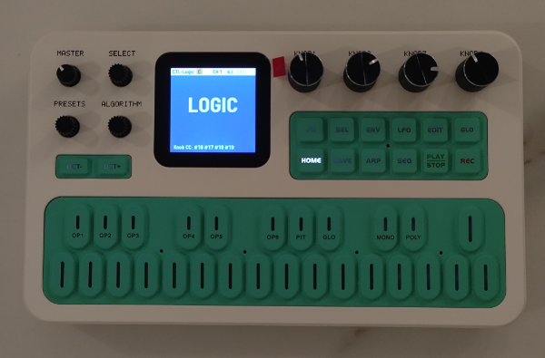

# CTL-Logic

CTL-Logic is an additional UI layer built on top of the [CTL-1 custom firmware (by charlesvestal)](https://github.com/charlesvestal/fm1-ctl). I added features to make it more usable as a portable midi controller/control surface for audio/mixing (DAW's like Logic Pro, Reaper, etc) and video editing. Midi output is sent via USB midi and/or BLE midi.

Everything from the original CTL-1 custom firmware is still there. Press the Home button to switch between the CTL-Logic and CTL-1 interface.

[Try it in the browser](https://asibal.github.io/ctl-logic/emu/)

[Install from the browser](https://asibal.github.io/ctl-logic/install/)

**Install at your own risk.** I have only tried this on my own device. Install the official v15 firmware before installing this. I suggest using [FM-1 Backup & Restore](https://github.com/workeffortwaste/fm1-backup-restore/) (Android) to make sure you can backup and restore your own device before installing any custom firmware.



**Main Features**
- Main screen displays the current channel name in large font and custom color. You will know your current channel by just glancing.
- Channel names and colors are editable (16 channels) . No need to remember channel numbers.

**Maximize the rotary encoders**
- Knobs 1-4 have editable CC
- 4 banks with quick bank switcher buttons
- Select & Algorithm knob have hardcoded CC's.
- Preset knob as channel switcher (1-16)
- All knobs send relative values (2's complement format)

**All buttons send CC's**
- All buttons send CC's, including the keyboard midi buttons (hardcoded CC's). Keyboard midi notes still work on CTL-1 Play Mode.

**Tips**
- Use one app or plugin per channel. You have 16 channels with 4 banks each.
- Use keys 21, 23, 25 (the last black keys) to quickly switch banks A, B, C. Key 25 will only toggle bank C & D which is useful if you only need 2 banks.
- Whenever you switch channels, it will go back to bank C as default. This is because bank A & B is mainly used by the CTL-1 keyboard, but you can still use it.
- To edit the channel names and colors, press Home > Global Settings > Use Select Knob to navigate to Channel Names. Use Preset Knob to select channel. Use Knob 1 as cursor, Knob 2 as character selector, Knob 3 as color selector.
- Since Logic 12, you can now control multiple instances of the same plugin and control them using different CC's. You will have to map each instances (e.g. first instance, second instance as needed). Use a different channel for each instance. That's why the default channel names have EQ 1, EQ 2, etc.
- I suggest using the default CC's so you won't lose all your Logic controller assignments if you have to re-flash the firmware. Remember to also save your Logic controller assignments to a file.

# Everything below is from the original CTL-1 project:

# CTL-1 for the M-VAVE FM-1 

CTL-1 turns the M-VAVE FM-1 into a MIDI controller. The keys play notes, with velocity and aftertouch read
from the keys themselves, in any scale with its chords under the black keys; the knobs send controllers in four banks; an arpeggiator and a four-track
Euclidean drum sequencer run on its clock. Everything goes out over USB and Bluetooth, MIDI from the TRS jack
is passed along, and the FM-1 plays it all on its own General MIDI sounds too, so it works with nothing connected.

  

- **Try it in your browser** (no FM-1 needed): <https://charlesvestal.github.io/fm1-ctl/emu/>
- **Install it** (Chrome or Edge, with the FM-1 plugged in): <https://charlesvestal.github.io/fm1-ctl/install/>
- **Read the manual**: <https://charlesvestal.github.io/fm1-ctl/manual/> (source: [docs/MANUAL.md](docs/MANUAL.md))
- **Download the firmware file**: [releases](https://github.com/charlesvestal/fm1-ctl/releases): `ctl-X.Y.fwsc` has
  USB, TRS and Bluetooth MIDI, `ctl-usb-X.Y.fwsc` the same without Bluetooth

Installing it is at your own risk, though it's hard to get stuck: the web installer can put
M-VAVE's own firmware back, and an FM-1 that fails to start twice comes up in a safe mode the
installer can reach.

## In short

| | |
|---|---|
| Keys | Notes; with a scale, its notes on the white keys and its chords on the black keys |
| KNOB 1–4 | The page's four values; on Play, four controllers in four banks |
| HOME · SEL · ARP · SEQ · EDIT · GLO | The pages: Play, Keys, Arp, Sequencer, Sound, Setup |
| SELECT | The page's own pages: the banks on Play, the tracks on the Sequencer |
| ALGORITHM · PRESETS · MASTER | MIDI channel · program change (the sound follows) · volume |
| FX | The next bank; held, KNOB 1–4 set its controller numbers |
| ENV · LFO | Sustain (tap twice to lock) · mod wheel |
| PLAY · REC · SAVE | Start / stop · panic · save |
| OCT− / OCT+ | An octave down or up |

The [manual](https://charlesvestal.github.io/fm1-ctl/manual/) has the rest.

### Screen reader

CTL-1 tells the [FM-1 Screen Reader](https://charlesvestal.github.io/fm1-reader/) what its screen shows,
over USB: the page and its knobs, a knob's value as it turns (a controller with its name, "CC 74 cutoff
64"), the channel and the program, the Sequencer's steps and mutes, the Touch settings, play and stop,
and what each button did (the notes you play are not read out). Open the
page in Chrome with the FM-1 plugged in; it speaks with its own voice, or hands the text to your
computer's screen reader. The reader's messages stay between it and CTL-1: they are never passed on to
Bluetooth.

## Building and testing

CTL-1 is an app on [fm1-base](https://github.com/charlesvestal/fm1-base) (`base/`, a git submodule); clone with
`--recursive`. The toolchain and prerequisites are in [BUILDING.md](BUILDING.md):

```
sh tests/run_tests.sh                                  # the app in the simulator, the emulator, the update path
./build.sh                                             # app/build/ctl.fwsc
./build.sh --no-ble                                    # app/build/ctl-usb.fwsc: without Bluetooth
python3 base/tools/fm1_install.py app/build/ctl.fwsc   # install it over USB
```

`app/build/host/ctl_host SCRIPT OUTDIR` runs the whole app on a computer from a script
(`tests/scenarios/*.ctl`), with screenshots and the MIDI sent coming out; `tools/gen_screens.sh` makes the
manual's screenshots. `./build.sh --web` builds the same code for the browser (the emulator), which can play a
real MIDI port through Web MIDI.

Bluetooth starts at every boot and advertises as "FM-1" (on a Mac: Audio MIDI Setup, Window, Show MIDI Studio,
the Bluetooth button, Connect); the Setup page shows the stack's log, which survives a reset.

## Credits

The platform (hardware layer, USB, update loader, storage, installer, Bluetooth) is
[fm1-base](https://github.com/charlesvestal/fm1-base) on [felucca-bsp](https://github.com/hugelton/felucca-bsp),
from [Felucca](https://github.com/hugelton/Felucca) by Leo Kuroshita (Hügelton Instruments), by way of
[X0X](https://github.com/charlesvestal/fm1-x0x) and [FoMni-1](https://github.com/charlesvestal/fm1-fomni);
the top bar and knob row are X0X's. Bluetooth runs on JieLi's Bluetooth libraries (Apache-2.0). The General MIDI sounds are Sonivox EAS (Apache-2.0). The Euclidean
rhythms are Godfried Toussaint's reading of Bjorklund's algorithm. The idea of running FM-1 firmware in
the browser comes from [Groove OS](https://www.groove-os.com/). MPL-2.0; see [LICENSING.md](LICENSING.md).
